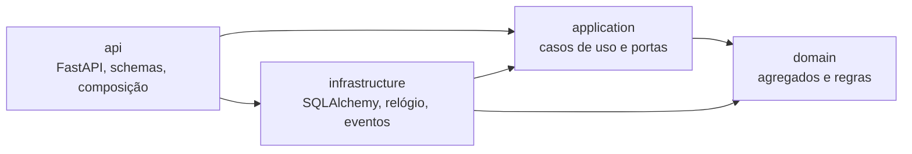

# SalaCerta

[](../../actions/workflows/ci.yml)

Sistema de reserva de salas de reunião. O problema é pequeno de propósito: o objetivo é mostrar **Domain-Driven Design** aplicado sem exagero, com um domínio que tem regras de verdade, como impedir que duas pessoas reservem a mesma sala no mesmo horário.

**Stack:** Python 3.13, FastAPI, SQLAlchemy 2, Alembic, PostgreSQL · React, TypeScript, Vite, TanStack Query · Docker, GitHub Actions

## Como rodar

### Com Docker

```bash
docker compose up --build
```

Acesse o app em <http://localhost:8080>.

### Sem Docker

O backend usa SQLite por padrão, então não é preciso instalar um banco.

```bash
cd backend
python -m venv .venv
.venv/Scripts/activate        # Linux/macOS: source .venv/bin/activate
pip install -e ".[dev]"
alembic upgrade head
uvicorn salacerta.api.main:app --factory --reload
```

Em outro terminal:

```bash
cd frontend
npm install
npm run dev
```

Acesse o app em <http://localhost:5173> e a documentação da API em <http://localhost:8000/docs>.

## Regras de negócio

- Uma sala não aceita duas reservas ativas em horários que se sobrepõem.
- Uma reserva pode começar no exato minuto em que a anterior termina.
- O número de participantes não pode passar da capacidade da sala.
- A reserva dura de 15 minutos a 8 horas e precisa começar no futuro.
- Sala desativada não aceita novas reservas; as que já existem continuam valendo.
- Só é possível cancelar uma reserva que ainda não começou.

## Arquitetura

As dependências sempre apontam para o domínio, que não conhece banco nem framework. Essa regra é verificada por um teste automatizado ([`test_architecture.py`](backend/tests/unit/test_architecture.py)).



```text
backend/src/salacerta/
├── domain/           Room, Booking, TimeSlot, eventos, erros, contratos de repositório
├── application/      ScheduleBooking, CancelBooking, CreateRoom... e as portas
├── infrastructure/   Repositórios, Unit of Work, modelos ORM, configurações
└── api/              Rotas, schemas HTTP, tradução de erros, injeção de dependências
```

### Onde cada conceito de DDD aparece

| Conceito | No código | Por quê |
| --- | --- | --- |
| Linguagem ubíqua | `Room`, `Booking`, `TimeSlot`, `schedule`, `cancel` | O código usa os mesmos termos do negócio, sem `update_status` genérico. |
| Agregados | [`Room`](backend/src/salacerta/domain/room.py), [`Booking`](backend/src/salacerta/domain/booking.py) | Cada um protege as próprias regras e só muda pelos próprios métodos. |
| Value objects | [`TimeSlot`, `EmailAddress`](backend/src/salacerta/domain/value_objects.py) | São imutáveis e sempre válidos; a regra de sobreposição mora em `TimeSlot.overlaps`. |
| Serviço de domínio | [`schedule_booking`](backend/src/salacerta/domain/services.py) | A regra envolve dois agregados e não pertence a nenhum deles sozinho. |
| Eventos de domínio | [`BookingScheduled`, `BookingCancelled`](backend/src/salacerta/domain/events.py) | Publicados só depois do commit. Hoje vão para o log, e uma fila entraria sem mudar os casos de uso. |
| Repositórios | [contratos](backend/src/salacerta/domain/repositories.py) e [implementação](backend/src/salacerta/infrastructure/repositories.py) | O domínio define o que precisa; a infraestrutura define como fazer. |
| Unit of Work | [`UnitOfWork`](backend/src/salacerta/application/ports.py) | Deixa explícito o limite da transação em cada caso de uso. |

### Decisões técnicas

- **Reserva dupla sob concorrência.** Verificar o conflito e depois gravar não basta: duas requisições simultâneas passariam juntas pela verificação. O caso de uso trava a linha da sala (`SELECT ... FOR UPDATE`), o que serializa os agendamentos por sala sem afetar as demais. Um teste dispara 8 requisições simultâneas contra PostgreSQL real no CI e exige exatamente uma reserva criada.
- **Agregados separados.** Colocar as reservas dentro de `Room` protegeria o conflito naturalmente, mas obrigaria a carregar todo o histórico da sala a cada operação.
- **Domínio separado do ORM.** Os agregados são dataclasses puras e os modelos SQLAlchemy ficam na infraestrutura. Há mais código de conversão, em troca de testes de domínio sem banco.
- **Horários em UTC.** O `TimeSlot` rejeita horário sem fuso e normaliza para UTC. O frontend converte para o fuso de quem está usando.
- **Relógio injetado.** O "agora" é uma porta (`Clock`), o que torna determinísticos os testes de regras que dependem de tempo.

### O que ficou de fora

Autenticação e permissões não foram implementadas para manter o foco no domínio. Hoje qualquer pessoa pode cancelar qualquer reserva. Em produção, esse seria o próximo passo, junto com a publicação confiável de eventos (outbox).

## Testes

```bash
cd backend
pytest
ruff check .
mypy
```

```bash
cd frontend
npm test
npm run build
```

| Tipo | Local | O que cobre |
| --- | --- | --- |
| Domínio | `tests/unit/test_domain.py` | Regras de negócio, sem banco e sem HTTP. |
| Aplicação | `tests/unit/test_application.py` | Casos de uso com Unit of Work em memória. |
| Arquitetura | `tests/unit/test_architecture.py` | Regra de dependência entre as camadas. |
| Integração | `tests/integration/` | API, banco, migrações e concorrência. |
| Frontend | `frontend/src/lib/time.test.ts` | Cálculos da linha do tempo. |

O teste de concorrência é ignorado no SQLite. Para rodá-lo localmente, defina `TEST_DATABASE_URL` apontando para um PostgreSQL de testes, cujas tabelas são recriadas a cada teste. O CI roda a suíte contra PostgreSQL e também sobe a pilha completa com Docker Compose.
